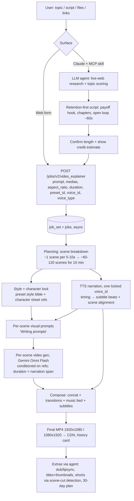

# 01 — Reverse Engineering: Higgsfield Explainer

> **Research date:** 2026-10-10/11.
> **Scope:** public pages only. No login, no credits spent, no credentials entered.
> **Tooling:** REA `rea-agents@6.3.0`, driven through its CLI (see DECISIONS D003), against an **isolated headless Chrome with a throwaway profile**. Also used: public API docs, web research, and in-browser frame analysis of public demo videos.
> **Rule followed:** we document *behavior and interfaces*. No Higgsfield code, prompts, branding, or assets are copied into this project. Short identifiers such as endpoint paths and enum values are quoted only as evidence.

## 0. Evidence key

| ID | Source | What it is |
|---|---|---|
| **E1** | REA `inspect_web_page` on https://higgsfield.ai/explainer-intro | Evidence `ev_9885b4ee…`. Landing page structure, accessibility text, 16 scripts (PostHog, Cloudflare). |
| **E2** | Server-rendered HTML of /explainer-intro | FAQ answer text; demo video URLs on `a.storyblok.com`; links to `/explainer` and `/supercomputer/marketplace/skills/higgsfield-explainer`. |
| **E3** | REA `inspect_web_page` on https://higgsfield.ai/explainer (logged out) | The app UI: controls, 22 style presets, "Generate ~200", Clerk storage keys. |
| **E4** | Chrome DevTools Protocol network capture, logged out, enabled before navigation | `cms.higgsfield.ai/video-explainer-presets`, `fnf-api-gw.higgsfield.ai/fnf/*`, `clerk.higgsfield.ai`, `/notices` (exposes the `job_set_types` concept). |
| **E5** | REA `analyze_web_bundle` (evidence `ev_cad5bc20…`, 1,526 scripts) plus REA `export_web_scripts` (evidence `ev_2fc4d185…`) | Static strings: job types, validation constants, the submit payload, `/job-sets/*` endpoints, Supercomputer agent tool names. |
| **E6** | Public i18n bundle `higgsfield.ai/_i18n/en.e46ff20b34.json` (35,945 strings) | UI state labels: "Planning", "Writing script", "Writing prompts", "Generating audio", "Generating video", "Composing", "Assembling", "Rendering", and others. |
| **E7** | `GET https://fnf-api-gw.higgsfield.ai/fnf/job-sets/costs` (public, no auth) | Credit cost formulas for 45 job-set types. |
| **E8** | https://higgsfield.ai/blog/faceless-channel-one-prompt | The "one prompt" workflow inside Claude: MCP connector plus the `higgsfield-explainer` skill. |
| **E9** | https://higgsfield.ai/mcp, and an unauthenticated MCP handshake to `mcp.higgsfield.ai/mcp` | The endpoint returns 401. OAuth metadata: Clerk PKCE or device-code flows. The tool list requires login. |
| **E10** | https://docs.higgsfield.ai (public REST API docs, plus llms.txt) | Request lifecycle, polling, webhooks, uploads, rate limits, billing. |
| **E11** | https://higgsfield.ai/skills/faceless | Sibling "Faceless video" skill: 10 styles; names "Gemini Omni Flash". |
| **E12** | [AlphaSignal, 2026-07-02](https://alphasignal.ai/news/higgsfield-ai-ships-explainer-to-turn-any-topic-into-a-10-minute-documentary) | Names "Claude Fable 5" and "Gemini Omni Flash"; says visuals change every 5–10 s. |
| **E13** | [postium.ru, 2026-07-03](https://postium.ru/higgsfield-zapustila-explainer/) | Names Claude Fable 5 and Gemini Omni Flash. |
| **E14** | [The Rundown review, 2026-08-31](https://www.therundown.ai/tools/higgsfield-explainer) | Third-party feature list and caveats. Its authors did not run the tool. |
| **E15** | In-browser frame-difference analysis of 3 public demo MP4s (Storyblok "mini" previews) | Resolution, duration, cut timestamps. |

Confidence levels: **High** = observed directly in code, network traffic, or first-party docs. **Medium** = first-party marketing, or several secondary sources agree. **Low** = inferred.

---

## 1. Feature inventory

| # | Feature | Finding | Evidence | Conf. |
|---|---|---|---|---|
| F1 | Input: topic or script | Text box labeled "Type a topic, or attach files below". Up to **3 attachments** (files or links) and up to **14 reference media** items. Prompt limit **5,000 chars**. Submission needs a prompt or at least one attachment. | E3, E5 (`VIDEO_EXPLAINER_MAX_ATTACHMENTS:3`, `MAX_MEDIAS:14`, `o.length>5e3`) | High |
| F2 | Duration | `"auto"` or a whole number of seconds from **15 to 600**. The UI default is **1 m**. The blog says the Claude skill *recommends 10 min*. | E3, E5 (`MIN_DURATION_SECONDS:15`, `MAX_DURATION_SECONDS:600`), E8 | High |
| F3 | Aspect ratios | Exactly `16:9` and `9:16` (enum `ii=['16:9','9:16']`). Marketing says both come "from one render" / "a single generation". The web form sends one `aspect_ratio` per job. | E5, E2 | High (enum) / Medium ("one render") |
| F4 | Style presets | **22 presets** from the CMS, for example Editorial Motion Graphics (default), Stickman Cartoon, Watercolor Chronicle, Pastel Flat 2D, Paper Diorama, Whiteboard Doodle, Pixel Art, Claymotion, Low Poly, Isometric Flat Vector. Each preset has a preview MP4. | E3, E4 (`/video-explainer-presets` → `total:22`) | High |
| F5 | Voice | Single narrator choice (default "Cillian"). The payload carries `voice_id` plus `voice_type`; `voice_type` suggests the voice is either a library preset or a user clone. | E3, E5 | High |
| F6 | Subtitles | Toggle. When on, the client **appends a natural-language instruction to the prompt**; there is no dedicated parameter. | E5 (`si(prompt, links, withSubtitles ? text : undefined)`) | High |
| F7 | Cost preview | "Generate ~200" for the default 1 m setting. A "How calculations work?" link. The cost is computed from `duration` only. | E3, E5 (`credits: Or(duration ?? 'auto')`) | High |
| F8 | Topic research | The skill "researches topics on the live web, scores them, and picks one with a one-line reason". UI strings include "Recommended topics", "Popular topics", "Generate new topic suggestions", "Researching YouTube/TikTok/Instagram". | E8, E6 | Medium |
| F9 | Retention-first script | Hook opens on the payoff, the video is split into chapters, an open loop appears about every minute. | E8 | Medium (marketing) |
| F10 | Consistency | "Same characters, same style, same voice" across the video. "Characters and style stay consistent" across a series. UI strings include "Generating a character sheet" and "Create characters and locations to reuse across scenes". | E1, E2, E6 | Medium (mechanism inferred) |
| F11 | Translate / re-dub | Prompting re-renders in another language, optionally with a cloned voice. Platform job types include `dubbing_lipsync` (3 cr/s at 25 fps) and `voice_change_merge` (0.1 cr/s). | E8, E5, E7 | Medium |
| F12 | Voice cloning | Audio → Voice Presets: record a sample script and upload (~1 min). UI strings: "Clone Voice", "Upload voice sample". | E8, E6 | Medium |
| F13 | Titles and thumbnails | "3 title options and 3 thumbnails" on request, done by the agent with image models. | E8 | Medium |
| F14 | Shorts | About 20 cut and captioned shorts via "Shorts Studio" and a "Shorts Maker" employee (`/supercomputer/marketplace/employees/shorts-maker`). The agent has a `detect_scene_cuts` tool. | E8, E5 | Medium |
| F15 | 30-day content plan | 8 long videos with topics ranked by search volume, each with a shorts batch. Done by the agent; no dedicated job type was found. | E8 | Medium |
| F16 | Parallel rendering | "Videos two and three render while you publish the first." This is a natural fit for the async job-set model. Account concurrency limits apply (the API docs example shows 4). | E8, E10 | Medium |
| F17 | Surfaces | (a) Web app `/explainer`. (b) Supercomputer skill `video-explainer-workflow` (id `youtube-explainer`). (c) MCP `mcp.higgsfield.ai/mcp` used from Claude, ChatGPT, Cursor, and others. (d) CLI. | E3, E5, E9, E12 | High |
| F18 | Sibling product | "YouTube faceless" channel studio: `/jobs/v2/youtube_faceless_video`, with `/youtube-faceless/channels` and `/youtube-faceless/hot-right-now` endpoints. Pricing comes in `scene_based` and `fully_animated` modes. | E5, E7 | High (exists) |
| F19 | History / feed | "History" tab, a liked-explainers feed (`video-explainer-feed`), and "Grab the finished explainer from your history when it's ready." | E3, E6 | High |
| F20 | Background music | Mentioned by the creator hub, the faceless skill page, and The Rundown. No music parameter is in the web payload, so the backend picks the music. | E14, search results | Medium |

### Verification of the model claims

| Claim | Verdict | Evidence |
|---|---|---|
| "Claude Fable 5" writes the research, scripts, and prompts | **Confirmed by multiple public sources** (first-party blog plus two press articles). In the MCP flow, the "brain" is the *user's own Claude client* running Higgsfield's skill. On Supercomputer the planning LLM is presumably the same model, but this was **not observed in code**. | E8, E12, E13 |
| "Gemini Omni Flash" generates the video | **Confirmed by first-party and secondary sources.** It is named on the sibling faceless-skill page and in press. The cost table supports it: `gemini_omni` costs **3 cr/s**, and the explainer's "~200 cr per 60 s" works out to ≈3.33 cr/s, roughly Omni plus TTS and overhead. | E11, E12, E7 |
| A per-scene image model also feeds in | **Unknown.** Omni Flash may generate directly from text and reference images, or each scene may first get a keyframe from another model (for example `nano_banana_2_1` at 1.5–3 cr/image). | — |

---

## 2. User flow and UI screens

### Web app (`/explainer`, observed logged out, E3/E6)
1. **Composer screen**
   - Preset card ("Change" opens a gallery of 22 animated preset previews).
   - Topic textarea, plus "Attach files" and "Link".
   - Settings chips: **Aspect ratio** (16:9 | 9:16), **Duration** (Auto or a value, default 1 m), **Voice** (narrator picker with instant previews), and a **Subtitles** toggle.
   - A **Generate ~N credits** button and a "How calculations work?" link.
2. **Auth gate.** Clerk login or sign-up modal opens on Generate (`withAuthGuard:true`).
3. **Submission.** An optimistic history card appears and the tab switches to **History** (`onSuccess → mi('history')`).
4. **Progress.** The history card shows a stage label. Candidates from i18n: *Planning → Writing script → Writing prompts → Generating audio → Generating video → Composing / Assembling → Rendering*. Exact sequencing is unknown without a logged-in run.
5. **Done.** The video plays in History and can be downloaded (`/video-explainer/video-explainer-download` asset). Liked items appear in the feed.
6. **Errors** seen in i18n include "That narrator voice is no longer available", "That script is too long to narrate", "Planning failed", and "This render could not pass the reference content check".

### Conversational flow (Claude + MCP + skill, E8)
1. The user gives a one-line topic, or asks the skill to pick one.
2. The skill runs live-web research, scores candidate topics, and proposes one with a one-line reason.
3. It drafts a retention-first script: payoff hook, chapters, an open loop about every 60 s.
4. It asks for the length (10 min recommended) and shows the credit cost before rendering (E12).
5. It submits the render job and polls.
6. Follow-ups: translate or dub, 3 titles plus 3 thumbnails, about 20 shorts, a 30-day plan, and parallel renders.

---

## 3. End-to-end pipeline (inferred)

Evidence for the ordering:
- The planning string *"Planning the voiceover script, timing, subtitle beats, and scene alignment"* (E6) supports an **audio-first** timing model, with visuals sized to the narration.
- The stage labels come from E6.
- Scene density comes from E12 ("visuals change every 5–10 s") plus the "around a hundred scenes" claim (E8). That gives **60–120 scenes** for 10 minutes. Confidence: Medium.

---

## 4. Inferred API and job model

### 4a. Consumer web API (internal, from E4/E5; confidence High for shapes, Medium for semantics)
| Purpose | Call |
|---|---|
| Preset catalog | `GET cms.higgsfield.ai/video-explainer-presets?lang=en&size=N` → `{total, cursor, items:[{id, name, video:{url, width, height, thumbnail_url, …}, priority}]}` |
| Cost table (public) | `GET fnf-api-gw.higgsfield.ai/fnf/job-sets/costs` → `[{job_set_type, cost:[formula objects]}]` |
| Submit | `POST {fnf}/jobs/v2/video_explainer`, authenticated with a Clerk JWT. Body: `{ params:{ prompt, medias?:[{role:'image', data:{id, type:'media_input'}} \| {role:'file', data:{…}}], aspect_ratio, duration:'auto'\|15..600, preset_id, voice_id, voice_type }, client_meta:{source:'web', page:'video-explainer'} }` → `{ job_sets:[…] }` |
| Poll | `GET {fnf}/job-sets/{id}` → `{ …, jobs:[…] }`. Single job: `GET /jobs/{id}`. |
| Hide / delete | `POST /job-sets/{id}/hide`, retried with backoff `(n+1)^2 s`, up to 10 attempts |
| Client-side validation | prompt or media required; prompt ≤ 5000 chars; duration rule; aspect enum; medias ≤ 14 |

The model is a **job set** (one user action) containing **N jobs**, which could include sub-steps. A `job_set_type` keys pricing and notices. Pages track progress with optimistic feed updates plus polling. No WebSocket was observed while logged out (E4).

### 4b. Public developer API (E10; High)
- `POST https://api.higgsfield.ai/{model-path}` with `Authorization: Key {id}:{secret}` and an `Idempotency-Key` header. Returns `{status:'queued', request_id, status_url, cancel_url}`.
- Statuses: `queued → in_progress → completed | failed | nsfw | canceled`. `failed` and `nsfw` are refunded. Cancel only works while queued.
- Polling: start at 2 s, back off ×1.5 up to 10 s, with jitter. Webhooks: `?hf_webhook=URL`, retried for up to 2 h; dedupe on `request_id`.
- Uploads: `POST /files/generate-upload-url` → presigned PUT. Allowed types are JPEG, PNG, WEBP, GIF, WAV, and MP4. URLs expire after 1 h.
- Rate limit = **concurrency** (example: 4). Exceeding it returns `400 "Maximum number of concurrent requests (4)…"`. There is no `Retry-After`.
- `POST /estimate/{model-path}` returns `{credits, usd}`. Example: 1.5 cr = $0.094, so **≈ $0.063/credit at API rates**.
- Outputs are retained for at least 7 days. Copy them to your own storage.

### 4c. MCP (E9)
- `https://mcp.higgsfield.ai/mcp` uses OAuth 2.1 through Clerk: PKCE for Claude clients, device code for others. Scopes are `openid email offline_access`. The tool list was **not** inspected because that needs a login.
- Agent-side tool names visible in the Supercomputer bundle (E5) include `text_to_speech`, `audio_analyze`, `detect_scene_cuts`, `extract_document`, `workflow_run`, `workflow_search`, `report_video_explainer_output`, `clarify`, `todo`, `plan`, `implement`, `verify`, and `agent_memory`. This points to an **agentic orchestrator** wrapping the job API.

---

## 5. How consistency is likely achieved

None of this is directly observable; it is **inferred** from evidence.

| Mechanism | Evidence for it | Conf. |
|---|---|---|
| **Style bible from the preset.** Each preset is a fixed style specification (palette, line, texture, motion grammar) injected into every scene prompt. | 22 named presets with their own preview reels (E4). Marketing says "a consistent 2D illustrated look that you define up front" (E2). | Medium |
| **Character reference sheet.** Generated once per video or series and passed as reference images into every scene generation. | i18n strings "Generating a character sheet" and "Create characters and locations to reuse across scenes" (E6). `medias` allows up to 14 refs (E5). Series-level consistency claim (E2). | Medium |
| **Reference images in every call.** Omni-style models accept multi-image references; the platform has many "reference to video" endpoints. | E10 lists reference-to-video APIs (Wan, HappyHorse); `role:'image'` medias (E5). | Medium |
| **Image-to-video from keyframes.** Generate a per-scene keyframe that respects the refs, then animate it. | Common industry pattern. The platform has I2V models (Kling 3 Turbo I2V, E10). No direct proof for the explainer. | Low |
| **One locked voice.** A single `voice_id` and `voice_type` per job, used by one TTS pass. | E5 payload; "one voice throughout" (E1). | High |
| **One planning pass.** The whole script and every scene prompt are written by one LLM call or session with a shared context, so wording stays uniform. | "Writing script", then "Writing prompts" stages (E6). | Medium |

---

## 6. Timing and cost observations

| Item | Value | Evidence |
|---|---|---|
| Web UI estimate, 1 min | **~200 credits** | E3 |
| Implied rate | ≈3.3 cr/s, so ~2,000 cr for 10 min if linear (linearity not verified) | E3, E7 |
| `gemini_omni` | 3 cr/s at 720p, 1080p, and 4k | E7 |
| `youtube_faceless_video` | `scene_based`: 16 cr per 10 s (96/min). `fully_animated`: 41 cr per 10 s (246/min). | E7 |
| `text2speech_v2` (minimax, elevenlabs, seed_speech) | 15 (or 10) cost-units per 50 chars, at 100 units = 1 credit. A 10-min script (~9k chars) is therefore ≈27 credits, so TTS is negligible. | E7 |
| Credit → USD | API ≈ $0.063. Consumer plans range from about $0.075 (Starter $15/200) to $0.043 (Ultra $129/3000). | E10, E12 |
| **10-min video, estimated retail** | **≈2,000 cr ≈ $86–$150** depending on plan | derived |
| Render time | **Not published.** The platform says video renders "typically 2–5 min" per clip. With concurrency, a 10-min explainer is plausibly tens of minutes. | E6 (generic string) |
| Demo video specs | 1920×1080. In the 15 s hero clips, shots last about 3–10 s, with ~0.4–2 s dissolve transitions (multi-frame diff clusters at 1.6–3.6 s and 6.0–6.8 s). The 43 s promo montage cuts every ~1.5–2.5 s. These are trailer edits, so pacing confidence is Low. | E15 |

---

## 7. Open questions and unknowns

1. **Exact internal job graph.** We don't know whether one `video_explainer` job set spawns sub-jobs per scene (TTS, image, video, compose) or runs a single opaque pipeline. This needs a logged-in run while you watch, with network capture (`/job-sets/{id}` response shape). It costs about 200 credits for 1 min, and **only with your approval**.
2. **Whether keyframe images are generated first** (and with which model), or Omni generates video directly from text and refs.
3. **Whether both aspect ratios truly come from one render** (reframe or outpaint) or from two renders. The web form sends one `aspect_ratio`.
4. **Music source.** We don't know if it is generated (and with what model) or taken from a stock library, nor how ducking is handled.
5. **Caption styling** (burned-in vs. soft subs; word-level karaoke vs. phrase-level) and the subtitle font and position.
6. **Whether the cost is linear above 1 min**, and what the "auto" duration costs.
7. **Real scene count and per-scene duration** for a full 10-min output. No full-length public sample has been analyzed yet. Your blog walkthrough (`youtu.be/Bf74TY20CrM`) could be analyzed if you approve downloading it, or if you watch it and share timings.
8. **MCP tool schemas.** These need an OAuth login; we didn't do one.
9. **Topic scoring rubric and search-volume source** for the 30-day plan.
10. **Where Fable 5 runs on the web-app path.** Is the LLM step server-side on Higgsfield, with the explainer skill ≡ the backend `video_explainer` job?

### Implications for our build
- Copy the **interface shape**, not the implementation: an async job-set with per-scene jobs, idempotency keys, polling plus webhooks, a concurrency semaphore, refunds on failure, and a cost estimate before submission.
- Use **audio-first timing**: narrate, measure, then size the scenes.
- Plan for about **one scene per 6 s**, so roughly 100 scenes for 10 minutes. Lock the style bible, character sheet, and voice ID once per project and pass them to every call.
- Treat 16:9 and 9:16 as a **render-time framing decision**, not two separate generations, to control cost.
