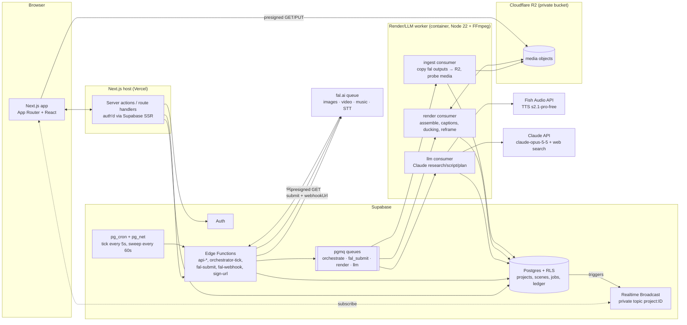
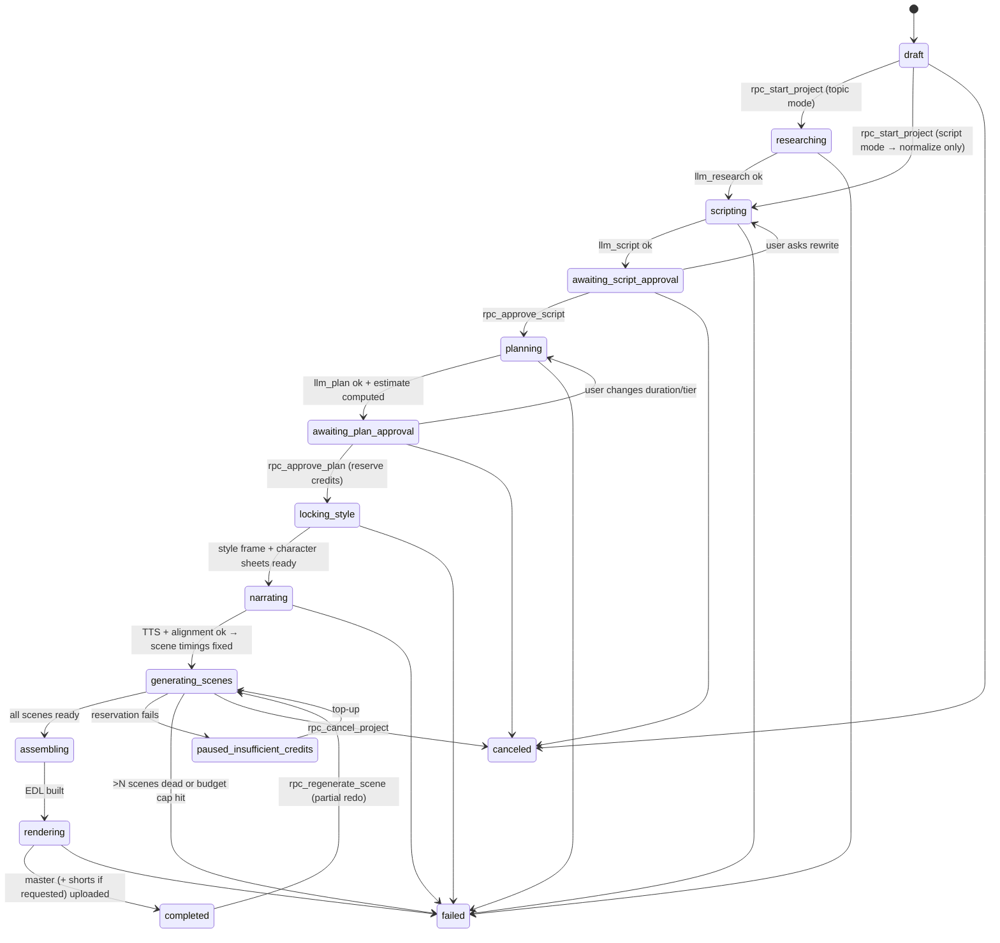
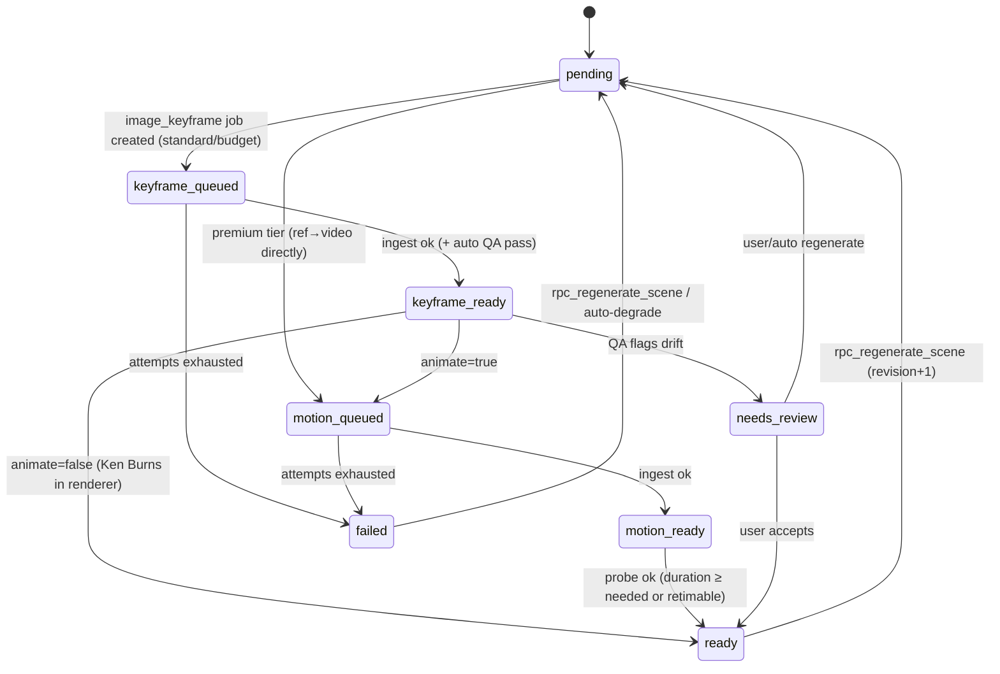

# 03 — Implementation Plan: AI Explainer Video Studio

> **Status:** PLAN ONLY. No application code is written until the user approves this document.
> **Inputs:** `01_REVERSE_ENGINEERING.md`, `02_STACK_RESEARCH.md` (§7 revision), `DECISIONS.md` (D001–D007).
> **Test scope (D007):** the UI supports **Short (9:16, ~30 s)** and **Full (16:9, up to 10 min)**. Generation is capped at **30 s** by `MAX_TEST_DURATION_S` until M4.
> **Working name:** "Lumen" (placeholder, change freely). Nothing here reuses Higgsfield names, prompts, presets, or assets.

---

## 1. Architecture



**Responsibilities**

| Component | Does | Must not do |
|---|---|---|
| Next.js | UI; server actions that call RPCs and Edge Functions; issues presigned URLs for playback and upload via `sign-url` | Hold the fal, Claude, or R2 secret keys in the browser |
| Edge Functions | Short (<5 s) steps: validate, reserve credits, enqueue, submit to fal, verify and apply webhooks, sign R2 URLs | Rendering, waiting on long LLM calls, downloading big media |
| Postgres | Source of truth, state machine transitions (SQL functions), queues, ledger | — |
| Worker | Long LLM calls (streaming), TTS, media copy/probe, FFmpeg renders | Anything the user's browser can reach directly. It has no public HTTP surface except `/healthz`. |
| R2 | All media bytes | Authorization. Every access goes through presigned URLs our backend issues. |

**Worker hosting (proposal):** Fly.io Machines (per-second billing, scale to zero, Docker). Alternatives are Railway and a small Hetzner VPS. *Pricing to verify at M0.* For local development the worker runs in Docker Desktop, which is already installed. FFmpeg ships inside the image, so nothing needs installing on Windows.

---

## 2. Data model: Supabase SQL schema with RLS

Conventions:
- `uuid` primary keys, `timestamptz` audit columns, `updated_at` maintained by a trigger.
- **Users read their own rows.** Pipeline tables are written only by the service role (Edge Functions and the worker) or through `security definer` RPCs that enforce state rules.
- Money is stored as integer **credits** (1 credit = $0.01 of *list* cost × markup; see §9).

```sql
-- =====================================================================
-- 0. Extensions & helpers
-- =====================================================================
create extension if not exists pgcrypto;
create extension if not exists pgmq;
create extension if not exists pg_cron;
create extension if not exists pg_net;

create or replace function public.set_updated_at() returns trigger
language plpgsql as $$ begin new.updated_at = now(); return new; end $$;

-- Enums
create type project_format    as enum ('short_9x16','full_16x9');
create type quality_tier      as enum ('budget','standard','premium');
create type project_status    as enum (
  'draft','researching','scripting','awaiting_script_approval',
  'planning','awaiting_plan_approval','locking_style','narrating',
  'generating_scenes','assembling','rendering','completed',
  'failed','canceled','paused_insufficient_credits');
create type scene_status      as enum (
  'pending','keyframe_queued','keyframe_ready','motion_queued',
  'motion_ready','ready','failed','needs_review');
create type job_status        as enum ('queued','submitted','in_progress','succeeded','failed','canceled','dead');
create type job_kind          as enum (
  'llm_research','llm_script','llm_plan','llm_titles','llm_shorts','llm_content_plan','llm_translate',
  'image_style_frame','image_character_sheet','image_keyframe','image_thumbnail',
  'video_motion','tts_chapter','stt_align','voice_clone','music_bed',
  'upscale','render_master','render_short','ingest_asset');
create type asset_kind        as enum ('image','video','audio','subtitle','json','archive');
create type ledger_reason     as enum ('grant','purchase','reservation','reservation_release','charge','refund','adjustment');

-- =====================================================================
-- 1. profiles
-- =====================================================================
create table public.profiles (
  id                uuid primary key references auth.users(id) on delete cascade,
  display_name      text,
  plan              text not null default 'test',          -- test | creator | pro
  max_concurrent_projects int not null default 1,
  daily_credit_cap  int  not null default 1000,           -- §9 cost control
  created_at        timestamptz not null default now(),
  updated_at        timestamptz not null default now()
);
create trigger trg_profiles_upd before update on public.profiles for each row execute function set_updated_at();
alter table public.profiles enable row level security;
create policy profiles_self_select on public.profiles for select using (id = auth.uid());
create policy profiles_self_update on public.profiles for update using (id = auth.uid())
  with check (id = auth.uid());   -- column grants below restrict which columns
revoke update on public.profiles from authenticated;
grant update (display_name) on public.profiles to authenticated;

-- auto-create profile on signup
create or replace function public.handle_new_user() returns trigger
language plpgsql security definer set search_path = public as $$
begin insert into public.profiles(id) values (new.id); return new; end $$;
create trigger on_auth_user_created after insert on auth.users
  for each row execute function public.handle_new_user();

-- =====================================================================
-- 2. style_bibles (reusable per user; one is snapshotted per project)
-- =====================================================================
create table public.style_bibles (
  id              uuid primary key default gen_random_uuid(),
  user_id         uuid not null references auth.users(id) on delete cascade,
  name            text not null,
  preset_key      text,                       -- our own preset catalog key, e.g. 'flat_editorial'
  spec            jsonb not null,             -- palette, line, texture, lighting, camera grammar, negatives (§4)
  system_prompt   text not null,              -- rendered from spec; passed to image model
  style_frame_asset_id uuid,                  -- FK added after assets table
  seed            bigint not null default (floor(random()*2147483647))::bigint,
  is_locked       boolean not null default false,
  created_at      timestamptz not null default now(),
  updated_at      timestamptz not null default now()
);
create trigger trg_sb_upd before update on public.style_bibles for each row execute function set_updated_at();

-- =====================================================================
-- 3. voices (library or cloned) + consent
-- =====================================================================
create table public.voices (
  id              uuid primary key default gen_random_uuid(),
  user_id         uuid references auth.users(id) on delete cascade,  -- null = global library voice
  provider        text not null check (provider in ('fish','minimax','elevenlabs')),
  provider_voice_id text not null,           -- fish reference_id / minimax custom_voice_id
  name            text not null,
  language        text not null default 'en',
  is_cloned       boolean not null default false,
  settings        jsonb not null default '{}', -- speed, pitch, emotion, stability...
  sample_asset_id uuid,
  consent_id      uuid,                      -- required when is_cloned
  last_used_at    timestamptz,               -- minimax clones expire if unused 7 days
  created_at      timestamptz not null default now()
);
create table public.voice_consents (
  id              uuid primary key default gen_random_uuid(),
  user_id         uuid not null references auth.users(id) on delete cascade,
  speaker_name    text not null,
  attestation     text not null,            -- exact text the user agreed to
  consent_recording_asset_id uuid,          -- speaker reads a consent sentence
  ip_hash         text,
  created_at      timestamptz not null default now()
);
alter table public.voices add constraint voices_consent_fk foreign key (consent_id) references public.voice_consents(id);
alter table public.voices add constraint cloned_requires_consent check (not is_cloned or consent_id is not null);

-- =====================================================================
-- 4. projects
-- =====================================================================
create table public.projects (
  id              uuid primary key default gen_random_uuid(),
  user_id         uuid not null references auth.users(id) on delete cascade,
  title           text,
  input_mode      text not null check (input_mode in ('topic','script')),
  input_text      text not null check (char_length(input_text) <= 20000),
  source_urls     text[] not null default '{}',
  format          project_format not null default 'short_9x16',
  target_duration_s int not null check (target_duration_s between 15 and 600),
  quality         quality_tier not null default 'standard',
  language        text not null default 'en',
  style_bible_id  uuid references public.style_bibles(id),
  voice_id        uuid references public.voices(id),
  subtitles       boolean not null default true,
  music           boolean not null default true,
  status          project_status not null default 'draft',
  status_detail   text,
  progress        numeric(5,2) not null default 0,       -- 0..100 for UI
  project_seed    bigint not null default (floor(random()*2147483647))::bigint,
  estimate_credits int,                                  -- shown at plan approval
  spent_credits   int not null default 0,
  budget_cap_credits int,                                -- hard stop for this project
  current_script_id uuid,
  final_render_id uuid,
  error           jsonb,
  created_at      timestamptz not null default now(),
  updated_at      timestamptz not null default now()
);
create index on public.projects(user_id, created_at desc);
create trigger trg_projects_upd before update on public.projects for each row execute function set_updated_at();

-- =====================================================================
-- 5. scripts (versioned) & chapters
-- =====================================================================
create table public.scripts (
  id              uuid primary key default gen_random_uuid(),
  project_id      uuid not null references public.projects(id) on delete cascade,
  version         int not null,
  source          text not null check (source in ('ai','user_edit','translation')),
  language        text not null default 'en',
  research        jsonb,              -- topic candidates, scores, citations
  hook            text,
  body            jsonb not null,     -- structured: chapters[{title, beats[{text, open_loop?}]}]
  full_text       text not null,      -- narration only, what TTS reads
  word_count      int not null,
  est_duration_s  numeric(7,2) not null,
  approved_at     timestamptz,
  created_at      timestamptz not null default now(),
  unique (project_id, version)
);
alter table public.projects add constraint projects_script_fk foreign key (current_script_id) references public.scripts(id);

create table public.chapters (
  id              uuid primary key default gen_random_uuid(),
  project_id      uuid not null references public.projects(id) on delete cascade,
  script_id       uuid not null references public.scripts(id) on delete cascade,
  idx             int not null,
  title           text not null,
  narration       text not null,
  audio_asset_id  uuid,                -- per-chapter TTS
  start_ms        int, end_ms int,     -- in the master narration timeline
  unique (script_id, idx)
);

-- =====================================================================
-- 6. characters (with reference images)
-- =====================================================================
create table public.characters (
  id              uuid primary key default gen_random_uuid(),
  project_id      uuid references public.projects(id) on delete cascade,
  user_id         uuid not null references auth.users(id) on delete cascade, -- reusable across series
  name            text not null,
  ref_tag         text not null,                 -- 'CHAR_A' used in prompts
  description     text not null,                 -- canonical visual description (frozen once locked)
  sheet_asset_id  uuid,                          -- turnaround sheet
  ref_asset_ids   uuid[] not null default '{}',  -- front, 3/4, profile, expression crops
  seed            bigint not null default (floor(random()*2147483647))::bigint,
  is_locked       boolean not null default false,
  created_at      timestamptz not null default now()
);

-- =====================================================================
-- 7. scenes
-- =====================================================================
create table public.scenes (
  id              uuid primary key default gen_random_uuid(),
  project_id      uuid not null references public.projects(id) on delete cascade,
  chapter_id      uuid references public.chapters(id) on delete set null,
  idx             int not null,                       -- 0-based order
  revision        int not null default 1,             -- bumps on "redo scene"
  narration       text not null,                      -- the words spoken over this scene
  word_start      int, word_end int,                  -- indices into alignment words
  start_ms        int, end_ms int,                    -- from alignment (timing truth)
  duration_ms     int generated always as (end_ms - start_ms) stored,
  shot_type       text,                               -- wide | medium | close | diagram | text_card
  visual_prompt   text not null,                      -- LLM-authored, style-agnostic
  motion_prompt   text,                               -- camera/subject motion for i2v
  character_ids   uuid[] not null default '{}',
  location_key    text,                               -- continuity grouping
  on_screen_text  text,                               -- optional label burned by renderer
  animate         boolean not null default true,      -- budget tier sets ~30% true
  seed            bigint not null,
  status          scene_status not null default 'pending',
  keyframe_asset_id uuid,
  keyframe_alt_asset_id uuid,                         -- 9:16 recomposition for shorts
  clip_asset_id   uuid,
  attempts        int not null default 0,
  error           jsonb,
  updated_at      timestamptz not null default now(),
  unique (project_id, idx)
);
create index on public.scenes(project_id, status);
create trigger trg_scenes_upd before update on public.scenes for each row execute function set_updated_at();

-- =====================================================================
-- 8. assets (registry of every R2 object)
-- =====================================================================
create table public.assets (
  id              uuid primary key default gen_random_uuid(),
  user_id         uuid not null references auth.users(id) on delete cascade,
  project_id      uuid references public.projects(id) on delete cascade,
  kind            asset_kind not null,
  r2_key          text not null unique,
  content_type    text not null,
  bytes           bigint,
  width int, height int, duration_ms int, fps numeric(6,3),
  sha256          text,
  source          text not null,             -- 'fal:<endpoint>', 'fish', 'render', 'upload'
  source_request_id text,                    -- fal request id
  meta            jsonb not null default '{}',
  created_at      timestamptz not null default now(),
  deleted_at      timestamptz
);
create index on public.assets(project_id);
alter table public.style_bibles add constraint sb_frame_fk foreign key (style_frame_asset_id) references public.assets(id);

-- =====================================================================
-- 9. jobs (every external/async unit of work)
-- =====================================================================
create table public.jobs (
  id              uuid primary key default gen_random_uuid(),
  project_id      uuid not null references public.projects(id) on delete cascade,
  scene_id        uuid references public.scenes(id) on delete cascade,
  kind            job_kind not null,
  provider        text not null,                    -- fal | fish | anthropic | worker
  endpoint        text,                             -- e.g. minimax/h3/image-to-video
  idempotency_key text not null unique,             -- §3.3
  status          job_status not null default 'queued',
  priority        smallint not null default 5,      -- 1 high .. 9 low
  input           jsonb not null,
  output          jsonb,
  fal_request_id  text unique,
  attempts        int not null default 0,
  max_attempts    int not null default 3,
  next_attempt_at timestamptz not null default now(),
  est_cost_usd    numeric(10,4),
  cost_usd        numeric(10,4),                    -- reconciled from provider usage
  credits_charged int not null default 0,
  error           jsonb,
  submitted_at timestamptz, started_at timestamptz, finished_at timestamptz,
  created_at      timestamptz not null default now()
);
create index on public.jobs(project_id, kind, status);
create index on public.jobs(status, next_attempt_at);

create table public.webhook_events (            -- raw log + dedupe for fal deliveries
  request_id      text primary key,
  received_at     timestamptz not null default now(),
  status          text not null,
  payload         jsonb
);

-- =====================================================================
-- 10. renders, shorts, thumbnails, content_plans
-- =====================================================================
create table public.renders (
  id              uuid primary key default gen_random_uuid(),
  project_id      uuid not null references public.projects(id) on delete cascade,
  kind            text not null check (kind in ('master','preview','dub')),
  aspect          text not null check (aspect in ('16:9','9:16')),
  resolution      text not null,                -- '1080x1920' etc
  language        text not null default 'en',
  edl             jsonb not null,               -- exact timeline used (§6) — reproducible
  asset_id        uuid references public.assets(id),
  subtitle_asset_id uuid references public.assets(id),
  status          job_status not null default 'queued',
  created_at      timestamptz not null default now()
);
alter table public.projects add constraint projects_render_fk foreign key (final_render_id) references public.renders(id);

create table public.shorts (
  id              uuid primary key default gen_random_uuid(),
  project_id      uuid not null references public.projects(id) on delete cascade,
  source_render_id uuid references public.renders(id),
  idx             int not null,
  title           text,
  hook_text       text,
  start_ms int not null, end_ms int not null,
  scene_ids       uuid[] not null default '{}',
  asset_id        uuid references public.assets(id),
  status          job_status not null default 'queued',
  unique (project_id, idx)
);

create table public.thumbnails (
  id              uuid primary key default gen_random_uuid(),
  project_id      uuid not null references public.projects(id) on delete cascade,
  title_text      text not null,
  prompt          text not null,
  asset_id        uuid references public.assets(id),
  is_selected     boolean not null default false,
  created_at      timestamptz not null default now()
);

create table public.content_plans (
  id              uuid primary key default gen_random_uuid(),
  user_id         uuid not null references auth.users(id) on delete cascade,
  niche           text not null,
  days            int not null default 30,
  plan            jsonb not null,               -- [{day, topic, angle, score, format, shorts_count}]
  created_at      timestamptz not null default now()
);

-- =====================================================================
-- 11. credits_ledger (append-only)
-- =====================================================================
create table public.credits_ledger (
  id              bigint generated always as identity primary key,
  user_id         uuid not null references auth.users(id) on delete cascade,
  project_id      uuid references public.projects(id) on delete set null,
  job_id          uuid references public.jobs(id) on delete set null,
  reason          ledger_reason not null,
  delta           int not null,                 -- + adds credits, - spends/reserves
  idempotency_key text unique,                  -- e.g. 'charge:'||job_id
  note            text,
  created_at      timestamptz not null default now()
);
create index on public.credits_ledger(user_id, created_at);
create view public.credit_balances with (security_invoker = true) as
  select user_id, sum(delta)::int as balance from public.credits_ledger group by user_id;

-- =====================================================================
-- 12. RLS — read-own on everything; writes via service role / RPC
-- =====================================================================
do $$ declare t text; begin
  foreach t in array array['style_bibles','voices','voice_consents','projects','scripts','chapters',
    'characters','scenes','assets','jobs','renders','shorts','thumbnails','content_plans','credits_ledger','webhook_events']
  loop execute format('alter table public.%I enable row level security', t); end loop; end $$;

-- owner-by-user_id tables
create policy sel_own on public.projects       for select using (user_id = auth.uid());
create policy sel_own on public.style_bibles   for select using (user_id = auth.uid());
create policy sel_own on public.characters     for select using (user_id = auth.uid());
create policy sel_own on public.assets         for select using (user_id = auth.uid() and deleted_at is null);
create policy sel_own on public.content_plans  for select using (user_id = auth.uid());
create policy sel_own on public.credits_ledger for select using (user_id = auth.uid());
create policy sel_own on public.voice_consents for select using (user_id = auth.uid());
create policy sel_own on public.voices         for select using (user_id = auth.uid() or user_id is null);

-- owner-via-project tables
create or replace function public.owns_project(p uuid) returns boolean
language sql stable security definer set search_path = public as
$$ select exists(select 1 from projects where id = p and user_id = auth.uid()) $$;

create policy sel_own on public.scripts    for select using (owns_project(project_id));
create policy sel_own on public.chapters   for select using (owns_project(project_id));
create policy sel_own on public.scenes     for select using (owns_project(project_id));
create policy sel_own on public.jobs       for select using (owns_project(project_id));
create policy sel_own on public.renders    for select using (owns_project(project_id));
create policy sel_own on public.shorts     for select using (owns_project(project_id));
create policy sel_own on public.thumbnails for select using (owns_project(project_id));
-- webhook_events: no policies => service role only.

-- Direct user writes allowed ONLY for: creating a draft project, editing draft fields.
create policy ins_own on public.projects for insert with check (user_id = auth.uid() and status = 'draft');
create policy upd_draft on public.projects for update
  using (user_id = auth.uid() and status in ('draft','awaiting_script_approval','awaiting_plan_approval'))
  with check (user_id = auth.uid());
revoke update on public.projects from authenticated;
grant update (title, input_text, source_urls, format, target_duration_s, quality, language,
              style_bible_id, voice_id, subtitles, music, budget_cap_credits) on public.projects to authenticated;
create policy ins_own on public.style_bibles for insert with check (user_id = auth.uid());
create policy upd_own on public.style_bibles for update using (user_id = auth.uid() and not is_locked);

-- All state transitions go through security-definer RPCs (validated, credit-checked):
--   rpc_start_project(project_id)              draft → researching|scripting (reserves LLM credits)
--   rpc_submit_script_edit(project_id, body)   new scripts row (source='user_edit')
--   rpc_approve_script(project_id, script_id)  → planning
--   rpc_approve_plan(project_id)               → locking_style (reserves full estimate)
--   rpc_regenerate_scene(scene_id, opts)       revision+1, new jobs (reserves scene cost)
--   rpc_cancel_project(project_id)             cancels queued jobs, releases reservations
--   rpc_create_voice_clone(consent payload)    voice_consents + job
-- Each RPC: checks owns_project(), checks status, checks balance & caps, writes ledger reservation, enqueues pgmq.

-- =====================================================================
-- 13. Realtime: private broadcast per project
-- =====================================================================
create policy rt_project_read on realtime.messages for select to authenticated
  using ( realtime.topic() like 'project:%'
          and owns_project( (substring(realtime.topic() from 9))::uuid ) );

create or replace function public.broadcast_project_change() returns trigger
language plpgsql security definer set search_path = public as $$
declare pid uuid := coalesce(new.project_id, old.project_id);
begin
  perform realtime.send(
    jsonb_build_object('table', tg_table_name, 'id', coalesce(new.id, old.id),
                       'status', to_jsonb(new)->>'status', 'row', to_jsonb(new)),
    'change', 'project:' || pid::text, true);
  return null;
end $$;
-- projects table broadcasts on its own id:
create or replace function public.broadcast_project_row() returns trigger
language plpgsql security definer set search_path = public as $$
begin perform realtime.send(to_jsonb(new), 'project', 'project:'||new.id::text, true); return null; end $$;
create trigger rt_projects after update on public.projects for each row execute function broadcast_project_row();
create trigger rt_scenes   after insert or update on public.scenes   for each row execute function broadcast_project_change();
create trigger rt_jobs     after insert or update on public.jobs     for each row execute function broadcast_project_change();
create trigger rt_renders  after insert or update on public.renders  for each row execute function broadcast_project_change();

-- =====================================================================
-- 14. Queues
-- =====================================================================
select pgmq.create('orchestrate');  -- {project_id} : advance state machine
select pgmq.create('fal_submit');   -- {job_id}     : submit a fal job (semaphore-gated)
select pgmq.create('llm');          -- {job_id}     : worker: Claude/Fish calls
select pgmq.create('ingest');       -- {job_id}     : worker: copy provider output → R2, probe
select pgmq.create('render');       -- {render_id}  : worker: FFmpeg
-- Queues are NOT exposed via pgmq_public to clients (service role only).
```

### 2.1 R2 object layout (bucket `lumen-media`, private)

```
u/{user_id}/
  voices/{voice_id}/sample.wav
  consents/{consent_id}/consent.wav
  styles/{style_bible_id}/style_frame_{seed}.png
  characters/{character_id}/sheet_v{n}.png
  characters/{character_id}/ref_{front|three_quarter|profile|expr_k}.png
  p/{project_id}/
    script/v{version}.json
    audio/chapter_{idx}.mp3
    audio/narration.wav               # concatenated master narration
    audio/alignment.json              # word timings
    audio/music_bed.mp3
    scenes/{idx:03d}/r{revision}/keyframe_16x9.png
    scenes/{idx:03d}/r{revision}/keyframe_9x16.png
    scenes/{idx:03d}/r{revision}/clip.mp4
    renders/{render_id}/master_{aspect}_{res}.mp4
    renders/{render_id}/captions.ass
    renders/{render_id}/edl.json
    shorts/{short_id}/short.mp4
    thumbs/{thumbnail_id}.png
    uploads/{asset_id}.{ext}          # user-attached files
```

- Keys are **immutable**. A redo writes a new `r{revision}` path, so old versions stay addressable for undo or compare.
- **Lifecycle rules:**
  - Delete `scenes/*/r*/` after 30 days for projects that are `completed` (the master render stays).
  - Delete `uploads/` after 90 days.
  - With R2's free 10 GB, a nightly cron reports usage and alerts at 8 GB.
- **Presigned URL TTLs:**
  - fal inputs: 1 h.
  - Browser playback: 15 min, refreshed by the UI.
  - Uploads: 10 min, PUT with exact `Content-Type` and length.

---

## 3. Pipeline state machines

### 3.1 Project state machine



**Two human checkpoints:** script approval, then plan approval with the credit estimate. These mirror the "confirm length" step seen in Phase 1. For 30-second tests, an "autopilot" toggle skips both checkpoints.

**Orchestrator (`orchestrator-tick` Edge Function):**
- `pg_cron` calls it every 5 s.
- It pops up to N messages from `orchestrate`.
- For each project it calls `advance_project(project_id)`, a SQL function that:
  1. reads current state plus job and scene aggregates,
  2. decides the next actions,
  3. inserts `jobs` rows with idempotency keys,
  4. enqueues them on the right queue,
  5. moves the project to its next status.

  This is one transaction per project, under `pg_advisory_xact_lock(hashtext(project_id))`.
- Any job finishing enqueues `orchestrate {project_id}`, so progress is event-driven. The cron tick is the safety net.

### 3.2 Scene state machine



**Auto-degrade:** if motion fails `max_attempts` times, the scene drops to `animate=false` (Ken Burns on the keyframe) instead of failing the whole project. The UI shows a badge for it.

### 3.3 Idempotency
- `jobs.idempotency_key = sha256(project_id | scene_id | kind | revision | canonical_json(input_without_urls))`. A duplicate insert is a no-op through `on conflict do nothing`.
- fal submit sends **our** `job_id` in its metadata. After submitting, we store `fal_request_id` under a unique constraint. If the Edge Function dies after fal accepted the job but before the database write, the sweeper finds `submitted` jobs with no `fal_request_id` older than 2 minutes. It cannot look them up by our ID, so it marks them `failed` and retries; the cost risk is one duplicate generation. This is mitigated by writing `status='submitting'` before the call and reconciling via `GET /v1/models/usage` nightly.
- **Webhook handler:**
  1. Verify the ED25519 signature.
  2. `insert into webhook_events … on conflict do nothing`. If the event was already seen, return 200.
  3. Look up the job by `fal_request_id` and apply the result through `apply_job_result(job_id, payload)`, which is guarded to run only when `status in ('submitted','in_progress')`.
  4. Enqueue `ingest`.
- **Ledger rows** carry `idempotency_key` (`'charge:'||job_id`, `'refund:'||job_id`), so double application is impossible.

### 3.4 Retries and failure handling
| Failure | Handling |
|---|---|
| fal 5xx / runner crash | fal retries internally (free). If the job still ends `ERROR`: `attempts+1`, `next_attempt_at = now() + 2^attempts × 15 s ± jitter`, resubmit. |
| fal 422 `content_policy_violation` | No retry with the same prompt. The worker asks the LLM to rewrite `visual_prompt` safely (one try). If that fails too, the scene goes to `needs_review`. |
| fal 429 / concurrency | Never surfaces with queue submit. Our semaphore keeps in-flight jobs ≤ `FAL_MAX_INFLIGHT`. |
| Missing webhook | A sweeper every 60 s polls `status_url` for jobs `submitted`/`in_progress` older than `expected_latency × 3`. |
| Claude error / refusal | SDK retries 429/5xx. A `refusal` stop reason uses the server-side fallback (D006), else the project goes to `failed` with an explanation. |
| Fish free-tier throttled | The provider interface falls back to `fal-ai/minimax/speech-2.8-hd` with the same text, and **voice consistency is kept by re-voicing the whole project, not mixing voices** (§4). |
| Worker crash mid-render | The pgmq visibility timeout (15 min for render) expires and another consumer re-runs. Renders are deterministic from `edl.json`. |
| Budget cap hit | Status `paused_insufficient_credits`. Reservations are released for unsubmitted jobs. |
| > 20% of scenes dead | Project `failed`. Reservations for unsubmitted work are released, and charges for completed work are kept, shown transparently. |

### 3.5 Parallelism limits
- **Global:** `FAL_MAX_INFLIGHT` (start at 2 to match fal's new-account concurrency, raise as fal raises it). Implemented as `select count(*) from jobs where provider='fal' and status in ('submitted','in_progress')` checked inside `fal-submit` under an advisory lock.
- **Per project:** `PROJECT_MAX_INFLIGHT = 4`. **Per user:** `profiles.max_concurrent_projects`.
- **Priority:** keyframes before motion, interactive redos before batch shorts. fal `priority: low` is used for shorts and content-plan work.
- **Fish:** `FISH_MAX_INFLIGHT = 4`, under the Starter limit of 5.

### 3.6 Partial regeneration ("redo scene 3")
`rpc_regenerate_scene(scene_id, {what: 'keyframe'|'motion'|'both', prompt_override?, new_seed?: bool})`:
1. Bump `revision`, reset the scene status, reserve credits for the scene only.
2. New jobs are created with new idempotency keys. The old assets remain at `r{n-1}`.
3. **Timing is unchanged**, because narration timing is fixed after alignment, so neighboring scenes are untouched.
4. Once the scene is `ready`, the orchestrator re-runs only `assembling → rendering`. The renderer reuses every other clip, and render time for a 30 s video is under 30 s.
5. **Narration edits** are a bigger change: they re-run `narrating` for the affected chapter, re-align, and recompute scene boundaries. Only scenes whose `[start_ms,end_ms]` changed by more than 300 ms are re-timed. Clips are retimed (§5) instead of regenerated where the change is ≤ 20%.

---

## 4. Consistency strategy (concrete)

**Locked once per project, in `locking_style`:**

1. **Style bible** (`style_bibles.spec`, rendered to `system_prompt`):
   ```json
   {
     "medium": "flat 2D vector illustration, editorial explainer",
     "palette": ["#1F2A44","#F2E8CF","#E76F51","#2A9D8F","#E9C46A"],
     "line": "uniform 3px dark navy outlines, rounded joins",
     "shading": "flat fills + one soft cel shadow, no gradients",
     "texture": "subtle paper grain 4% opacity",
     "lighting": "even, high-key",
     "composition": "rule of thirds, generous negative space for captions (bottom 22%)",
     "camera_grammar": ["slow push-in", "gentle pan", "parallax layers"],
     "negatives": ["photorealism", "3D render", "text artifacts", "extra fingers", "watermarks", "logos"]
   }
   ```
   - It is passed as `system_prompt` on **every** `nano-banana-2.1` call.
   - It is also appended as a compact suffix to every motion prompt.
   - **Our own preset catalog** (about 8 to start) is written from scratch: flat editorial, chalkboard sketch, paper cut-out, clay, ink wash, isometric, pixel, comic halftone.

2. **Style frame.** One reference image generated from the bible with `seed = style_bibles.seed`. Image ref #0 in every keyframe call.

3. **Character sheets.** For each recurring character, a single generation of a turnaround sheet (front, ¾, profile, 3 expressions) on a neutral background, using the style frame as a reference and `seed = characters.seed`. The worker crops it into `ref_asset_ids`. `description` is then frozen and used verbatim in every prompt that includes the character, as `CHAR_A: <description>`.

4. **Keyframe call** (standard and budget tiers), `google/nano-banana-2.1/edit`:
   ```
   image_urls  = [style_frame, CHAR_A.front, CHAR_A.three_quarter, CHAR_B.front, …,
                  prev_keyframe_same_location?]          # ≤ 14, ordered and named in prompt
   system_prompt = style_bible.system_prompt
   prompt = "Image 1 is the STYLE reference. Images 2–3 are CHAR_A (<frozen description>). …
             Scene: <visual_prompt>. Shot: <shot_type>. Keep CHAR_A's face, hair, outfit and
             proportions identical to the references. Leave the bottom 22% uncluttered."
   seed = hash64(project_seed, scene.idx, scene.revision) mod 2^31
   aspect_ratio = '9:16' | '16:9'; resolution = '1K' (tests) / '2K' (full)
   ```

5. **Motion call** (standard), `minimax/h3/image-to-video`:
   - `image_url = keyframe`, `prompt = motion_prompt + " Maintain the exact art style and character design of the first frame; no new characters; no text."`
   - `seed` is derived the same way. `duration = clamp(ceil(scene_s), 5, 15)`. `resolution = '768P'`.

6. **Premium** (`google/gemini-omni-flash/v1.1/reference-to-video`):
   - `image_urls = [style_frame, character refs…]`, with the prompt using `<IMAGE_REF_0>` (style) and `<IMAGE_REF_n>` per character.
   - There is no seed, so **consistency relies on refs**. We run the auto-QA pass (below) and regenerate outliers.

7. **Voice.** One `voices` row (provider and `provider_voice_id`) is set in `projects.voice_id` at plan approval and never changes mid-project.
   - TTS settings (speed, pitch, emotion) are stored on the voice and sent identically on every chapter.
   - If the provider has to fall back mid-project, **all chapters are re-voiced** with the fallback, so voices are never mixed.

8. **Auto QA (cheap drift check).** After each keyframe, a small vision check runs: Claude with the image, the character refs, and the style frame, at low effort. It returns `{style_match 0-1, character_match 0-1, issues[]}`. Below a threshold, the scene goes to `needs_review` or is auto-regenerated once with a new seed. The cost is about $0.002–0.01 per scene. Its results are logged for the M3 consistency experiment.

---

## 5. Timing strategy: narration first, visuals sized to audio

1. **Script word budget.**
   - `target_words = target_duration_s × 2.5` (≈150 wpm), so 30 s gives about 75 words and 10 min about 1,500.
   - After TTS, `measured_wpm` is calibrated per voice and stored in `voices.settings`, which improves future estimates.
2. **TTS per chapter.** Each call stays under 10,000 characters.
   - Chapters are joined with a 250 ms gap, giving `narration.wav`.
   - Loudness is normalized in the worker.
3. **Alignment.** `fal-ai/elevenlabs/speech-to-text/scribe-v2` on `narration.wav` returns `words[{text,start,end}]`. Words are matched to the script tokens with a small edit-distance aligner, so caption text uses **our** spelling.
4. **Scene boundaries.** The scene planner (LLM) assigns each scene a **word range** (`word_start..word_end`), not a duration.
   - `start_ms` is the first word's start minus 120 ms, and `end_ms` is the next scene's start. The last scene's `end_ms` is the last word's end plus 600 ms of tail.
   - The planner's constraints are scene lengths of 3.5–8 s (shorts) or 4–10 s (full), splitting at sentence and clause boundaries. A post-pass merges scenes shorter than 3 s and splits scenes longer than 12 s.
5. **Clip sizing.**
   - The requested model duration is `ceil(scene_s)` clamped to the model's allowed range: H3 5–15 s, Wan 2–30 s, Omni 3–10 s.
   - Scenes shorter than a model's minimum use Wan 3.0 (2 s minimum), or trim a longer clip.
   - In the renderer, the clip is trimmed to `scene_ms`. If it is too short by ≤ 20%, it is slowed with `setpts` (no visible judder at ≤ 1.2×). Beyond that, the last frame is held with a gentle zoom.
6. **Transitions.** 300 ms crossfades are centred on boundaries, so they don't shift narration sync.

---

## 6. Rendering and assembly (worker, FFmpeg)

**Input:** `edl.json`, built by `advance_project`, which is deterministic and stored on the render:
```json
{ "aspect":"9:16", "w":1080, "h":1920, "fps":30,
  "scenes":[{"idx":0,"src":"r2://…/clip.mp4","type":"clip|kenburns","in_ms":0,"dur_ms":5840,
             "kenburns":{"from":[0,0,1.0],"to":[0.04,0.02,1.08]}, "text":null}],
  "narration":"r2://…/narration.wav", "music":"r2://…/music_bed.mp3",
  "captions":{"words":[…], "style":"pop_word", "safe_bottom_px":420},
  "loudness":{"target_lufs":-14,"true_peak":-1.0},
  "transitions":{"type":"fade","ms":300} }
```

**Steps:**
1. **Normalize each scene.** Scale and crop to the target aspect (cover, centred), `fps=30`, `setpts` retime, trim. For budget scenes, `zoompan` Ken Burns on the 2K keyframe, rendered at 2× and downscaled to avoid jitter.
2. **Concatenate** with `xfade=transition=fade:duration=0.3` between scenes.
3. **Audio:**
   - Narration track.
   - Music bed: looped with `aloop` and a 2 s `acrossfade`, faded in and out, then **ducked** with `sidechaincompress` (threshold about −30 dB, ratio about 8, attack 20 ms, release 300 ms), keyed from the narration. Music sits at about −18 LUFS under the voice.
   - Final `loudnorm=I=-14:TP=-1.0:LRA=11` (two-pass).
4. **Captions** burned in via an `ass` subtitle file generated from alignment words.
   - *Short:* 1–3 words per cue, the active word highlighted, centred at about 62% of the height, bold rounded sans, 8 px outline, inside the platform safe area.
   - *Full:* phrase-level cues of up to 42 characters across 2 lines, bottom 12%.
   - A sidecar `captions.srt` is also produced for YouTube upload (soft subtitles keep accessibility and SEO).
5. **Encode:** H.264 High profile, CRF 20, `preset=medium`, `yuv420p`, AAC 192 kbps 48 kHz, `+faststart`.
6. Upload to R2, probe, and write the `assets` and `renders` rows. The poster frame comes from the scene with the highest QA score.

**16:9 vs 9:16:**
- The aspect is a **generation-time choice** per project. Keyframes and clips are generated natively in the target aspect.
- **Shorts derived from a full 16:9 video** (M6):
  - Scenes used in a short get a **9:16 recomposed keyframe**: `nano-banana-2.1/edit` with the 16:9 keyframe plus the style and character refs, prompted to "recompose vertically, same moment".
  - That keyframe is then Ken-Burns'd, or animated if the tier allows. Generation is never cropped blindly, because faces cut off at the edges.
  - A fallback is available: a centre crop with a blurred-fill background, for zero added cost.

---

## 7. Prompt-engineering plan (original templates)

All LLM steps use **structured outputs** (`output_config.format` with a JSON schema), `claude-opus-5-5` with adaptive thinking, explicit `effort`, and prompt caching on the static system prompt.

**T1 — Topic research and scoring** (topic mode). Tools: `web_search_20260209` (max_uses 8).
```
SYSTEM: You are a research producer for short educational videos. You find angles that are
true, specific, and surprising to a general audience. You cite sources for every factual claim.
USER: Seed topic: "{input_text}". Audience: {audience|general}. Language: {language}.
Find 5 candidate angles. For each: a one-line premise, the single most surprising true fact
(with source URL), why a viewer would care in the first 3 seconds, and scores 1–10 for
curiosity, clarity (can it be explained in {target_duration_s}s?), visual potential, and
evidence strength. Pick one and justify it in one sentence.
SCHEMA: {candidates:[{premise, key_fact, source_urls[], why_care, scores:{curiosity,clarity,visual,evidence}}], pick_index, pick_reason}
```

**T2 — Script.** Effort `high`.
```
SYSTEM: You write narration for faceless explainer videos. Spoken, plain words; short sentences;
no filler; every factual claim must be supported by the research notes provided — if it isn't,
leave it out. Never invent statistics, quotes, or dates.
USER: Angle: {pick}. Research notes: {notes+citations}. Format: {short|full}.
Target length: {target_words} words (±8%).
Structure rules:
- Open with the payoff or most striking fact in the first sentence (≤ 14 words); no greetings.
- {full}: 3–6 chapters, each with a one-line title; end every chapter with a question or a
  promise the next chapter resolves; place a curiosity hook roughly every 140 words.
- {short}: one arc — hook → 2–3 escalating beats → a satisfying closing line that reframes the hook.
- End with a single closing line; no "like and subscribe".
Also return: on_screen_terms (≤ 6 words to show as text), pronunciation_hints for unusual names.
SCHEMA: {title, hook, chapters:[{title, beats:[{text, is_hook:boolean}]}], full_text,
         word_count, on_screen_terms[], pronunciation_hints:[{term, say_as}], claims:[{text, source_url}]}
```

**T3 — Scene planner.** Effort `medium`. Runs after narration and alignment, so it gets word indices.
```
SYSTEM: You are a storyboard artist for 2D explainer videos. You turn narration into shots that
SHOW the idea (metaphors, diagrams, cause→effect), not literal talking heads. One idea per shot.
USER: Narration tokens with indices: {tokens}. Total duration: {ms}. Aspect: {aspect}.
Characters available: {CHAR_A: description, …} (use only these; may use none).
Style bible summary: {one line}. Constraints: each scene covers a contiguous word range,
{3.5–8s | 4–10s} long by the provided timings; vary shot types; no on-screen text except
on_screen_terms; avoid real brand logos and real people's likenesses.
For each scene return: word_start, word_end, shot_type, visual_prompt (what is in frame,
style-agnostic, ≤ 60 words), motion_prompt (camera + subject motion, ≤ 25 words),
characters[], location_key, on_screen_text|null, animate_priority (0–1).
SCHEMA: {scenes:[…]}
```
In the budget tier, `animate=true` is set for the top 30% of scenes by `animate_priority`.

**T4 — Character and style lock.** Effort `low`: it turns the user's style choice and the script's cast into a frozen `description` per character (age range, build, hair, outfit, palette indices, one distinctive accessory) plus the `spec` fields. These are used verbatim afterwards.

**T5 — Visual QA.** Effort `low`, with images. It returns `{style_match, character_match, issues[]}` with strict rubric anchors.

**T6 — Titles and thumbnails** (M6). It produces 3 titles: curiosity gap, number or specific, and benefit. Each is ≤ 60 characters, and the most important 2–3 words come first. For each title it writes a thumbnail concept: 2–4 words of on-image text, a dominant subject from our character refs, high-contrast palette indices, and "one emotion". These go to `ideogram/v4.5/edit` with the character refs.

**T7 — Shorts selection** (M6). Input: the full script with timings. Output: up to 20 segments of 20–55 s, each starting on a self-contained hook sentence, with no mid-sentence starts and a payoff inside the segment. It also writes a new 1-line text hook for the overlay and a title.

**T8 — 30-day content plan** (M6). It uses web search to produce `{day, topic, angle, why_now, est_search_interest(low|med|high, with evidence), format, shorts_count}`. Search-interest numbers are only claimed when a cited source supports them.

**Prompt hygiene:**
- All templates live in `packages/prompts` with versions (`prompt_version` is stored on each job).
- Evals are a fixed set of 20 topics with rubric scoring by an LLM judge plus a human spot-check (M3).

---

## 8. Milestones

Effort is in focused developer-days for one engineer working with Claude.

### M0 — Foundations (2–3 d)
- **Scope:**
  - Monorepo, CI, environments.
  - Supabase project (Free tier is fine for tests).
  - R2 bucket, CORS, and lifecycle.
  - Keys: fal, Anthropic, Fish.
  - Migrations for §2.
  - The worker skeleton in Docker.
- **Files:**
  ```
  apps/web/                      Next.js 15 (App Router), Tailwind, shadcn/ui, @supabase/ssr
  apps/worker/                   Node 22, pgmq consumer loop, ffmpeg-static/Docker ffmpeg
  supabase/migrations/0001_init.sql … (schema above)
  supabase/functions/{orchestrator-tick,fal-submit,fal-webhook,sign-url,api-*}/
  packages/core/                 domain types, state machine (pure TS, shared)
  packages/providers/            fal.ts, fish.ts, claude.ts, r2.ts (interfaces + impls)
  packages/prompts/              T1–T8 templates + JSON schemas
  infra/                         Dockerfile.worker, fly.toml, r2-lifecycle.json
  ```
- **Acceptance:**
  - `supabase db reset` applies cleanly.
  - RLS tests: user A can't read user B's project, scenes, or assets. Anonymous users can't read anything.
  - The worker connects, reads a test pgmq message, and acks it.
  - `sign-url` returns a working R2 GET/PUT URL, and fal accepts an R2 presigned URL as `image_url` (one $0.04 image, with your approval).

### M1 — 30-second Short, end to end (MVP) (5–7 d)
- **Scope:**
  - **UI:**
    - The create page with a **format switch (Short / Full)**. Full is visible, but duration is capped by `MAX_TEST_DURATION_S=30`, with a badge reading "Full videos coming in M4".
    - Topic or script input, style preset picker (8 of our own presets), voice picker (Fish library), tier picker.
    - Autopilot toggle.
  - **Pipeline:**
    - T1 → T2 → TTS (Fish) → alignment (Scribe) → T3.
    - Style frame, then 1–2 character sheets.
    - 5 keyframes, then motion (standard) or Ken Burns (budget).
    - Music, then render 9:16 with captions and ducking.
  - The project page shows live progress (Realtime), the scene grid, and the final player with download.
- **Files:** `apps/web/app/(app)/new`, `/projects/[id]`, `packages/core/pipeline/*`, `apps/worker/{llm,ingest,render}`, `supabase/functions/*`.
- **Acceptance:**
  1. Topic "why do cats purr" (Short, standard) produces a 26–34 s MP4 at 1080×1920 / 30 fps, −14 ± 1 LUFS, with captions in sync within ±150 ms (word-onset check).
  2. The same character is recognizable in every scene that lists it (manual check plus the QA score ≥ 0.7).
  3. Killing the worker mid-render still lets the project complete after a restart.
  4. Duplicate webhook deliveries don't double-charge (verified by replaying a recorded payload).
  5. Spend per run is ≤ $3.50 standard and ≤ $1 budget.

### M2 — Control and trust (4–5 d)
- **Scope:**
  - Script editor and approval.
  - Plan approval with the cost estimate.
  - **Redo scene N** (keyframe, motion, or both, with an optional prompt tweak).
  - Accept or reject QA-flagged scenes.
  - Cancel.
  - Credits ledger with reservations, refunds, and a balance UI.
  - Admin grant tool.
  - Per-project budget cap and per-user daily cap.
- **Acceptance:**
  - A redo of scene 3 re-renders only scene 3 plus a re-assembly in under 60 s.
  - The ledger balances: Σreservations − Σreleases = Σcharges for every project.
  - Cancel releases all unspent reservations.
  - A user can never go negative (concurrent-request test).

### M3 — Consistency experiment and premium tier (3–4 d)
- **Scope:**
  - Add Omni reference-to-video (premium).
  - A harness that runs 10 fixed topics × 3 tiers, collecting QA scores, human ratings, cost, and latency.
  - Tune prompts, seeds, and the reference set.
  - Write the results to `docs/04_CONSISTENCY_REPORT.md`.
- **Acceptance:**
  - The report shows identity and style scores per tier, and the default tier is chosen from the data.
  - The prompt eval set is stored and re-runnable.
- **Budget:** about $30–40 in fal spend, with your approval before running.

### M4 — Full format (16:9, up to 3 min → 10 min) (5–7 d)
- **Scope:**
  - Chapters UI.
  - Chunked TTS per chapter.
  - Scheduler under real concurrency (fal 2 → higher).
  - Raise `MAX_TEST_DURATION_S` in steps: 60 → 180 → 600.
  - Progress ETA.
  - Scene-grid virtualization for about 100 scenes.
  - Partial-failure auto-degrade.
- **Acceptance:**
  - A 3-minute video completes with ≤ 1 manual action.
  - A 10-minute video (about 100 scenes) completes inside an estimate of ±25%.
  - Memory in the worker stays under 2 GB (streamed renders, segment-wise concat).

### M5 — Voices and languages (3–4 d)
- **Scope:**
  - Voice cloning with a **consent flow**: an attestation, plus the speaker reading a randomized consent sentence, verified by STT match ≥ 0.9.
  - MiniMax clone keep-alive (a cron that uses each clone at least every 6 days).
  - Translate and re-dub: T2-translate, then TTS in the same voice, then re-align, re-time, and re-render.
- **Acceptance:**
  - A clone can't be created without a passing consent recording.
  - A Spanish dub of an M1 video has captions in sync and the same visuals, re-timed.

### M6 — Packaging and growth extras (4–5 d)
- **Scope:**
  - 3 titles and 3 thumbnails (T6).
  - **About 20 auto-cut captioned shorts** from a full video (T7, plus 9:16 recomposition).
  - A 30-day content plan (T8).
  - Batch rendering of several projects in parallel, with a queue view.
- **Acceptance:**
  - A 10-minute video yields at least 15 shorts that each start on a complete sentence and run 20–55 s.
  - Thumbnail text is legible at 320 px wide.
  - The plan cites a source for every "search interest" claim.

### M7 — Hardening and launch (4–6 d)
- **Scope:**
  - Payments (Stripe Checkout for credit packs: research and approve separately).
  - Observability: structured logs, cost dashboard from `jobs.cost_usd` plus fal usage reconciliation.
  - Storage lifecycle and R2 usage alerts.
  - Moderation: input prompt screening, and fal safety on.
  - YouTube disclosure helper.
  - Terms of service and privacy.
  - Switch TTS to paid Fish or MiniMax for commercial use.
  - Supabase Pro.
- **Acceptance:**
  - A load test of 10 concurrent Short projects shows no lost jobs.
  - The nightly cost reconciliation is within 2% of fal's usage API.

**Total:** about 30–41 developer-days to a full feature set. **M0–M1, the working 30-second short, is about 7–10 days.**

---

## 9. Configuration, cost controls, and the credit system

### 9.1 `.env.example`
```bash
# --- Next.js (apps/web) ---
NEXT_PUBLIC_SUPABASE_URL=
NEXT_PUBLIC_SUPABASE_ANON_KEY=
SUPABASE_SERVICE_ROLE_KEY=            # server-only
APP_BASE_URL=http://localhost:3000

# --- Supabase Edge Functions (set via `supabase secrets set`) ---
FAL_KEY=
FAL_WEBHOOK_URL=https://<project>.supabase.co/functions/v1/fal-webhook
FAL_MAX_INFLIGHT=2
PROJECT_MAX_INFLIGHT=4
R2_ACCOUNT_ID=
R2_ACCESS_KEY_ID=
R2_SECRET_ACCESS_KEY=
R2_BUCKET=lumen-media
R2_PRESIGN_TTL_FAL_S=3600
R2_PRESIGN_TTL_VIEW_S=900

# --- Worker (apps/worker) ---
DATABASE_URL=postgresql://...          # pooled, service role
ANTHROPIC_API_KEY=
CLAUDE_MODEL=claude-opus-5-5
CLAUDE_FALLBACK=default                 # server-side refusal fallback
FISH_API_KEY=
FISH_MODEL=s2.1-pro-free                # switch to s2.1-pro for production
TTS_FALLBACK_ENDPOINT=fal-ai/minimax/speech-2.8-hd
STT_ENDPOINT=fal-ai/elevenlabs/speech-to-text/scribe-v2
IMAGE_ENDPOINT=google/nano-banana-2.1/edit
VIDEO_STANDARD_ENDPOINT=minimax/h3/image-to-video
VIDEO_STANDARD_FALLBACK=alibaba/wan-3.0/image-to-video
VIDEO_PREMIUM_ENDPOINT=google/gemini-omni-flash/v1.1/reference-to-video
MUSIC_ENDPOINT=minimax/music-3
FFMPEG_THREADS=4
RENDER_TMP_DIR=/tmp/lumen

# --- Guardrails ---
MAX_TEST_DURATION_S=30
MAX_SCENES_PER_PROJECT=12               # raise in M4
GLOBAL_DAILY_SPEND_USD=25               # circuit breaker
CREDIT_MARKUP=1.0                       # 1.0 during testing (cost-pass-through)
QA_MIN_STYLE=0.7
QA_MIN_CHARACTER=0.7
```

### 9.2 Credits
- **1 credit = $0.01 of provider list cost × `CREDIT_MARKUP`.** During testing the markup is 1.0, so the ledger equals real cost.
- **Estimate** (shown at plan approval): Σ over planned jobs of `price_table[endpoint] × units` + 15% retry buffer + LLM estimate. The price table is seeded from `02_STACK_RESEARCH` and refreshed weekly from fal's pricing API.
- **Flow:** `reservation` (−estimate) at approval, then `charge` per finished job (actual), then `reservation_release` (+remainder) at completion, failure, or cancel. `refund` covers provider-side failures that we were charged for (rare; fal doesn't bill 5xx).
- The test plan seeds a **grant** of 2,000 credits ($20) per tester.

### 9.3 Cost controls
1. `MAX_TEST_DURATION_S` and `MAX_SCENES_PER_PROJECT` (hard caps, also checked in the RPC).
2. Per-project `budget_cap_credits` (default = estimate × 1.3), at which the project pauses.
3. Per-user `daily_credit_cap`.
4. **Global circuit breaker:** `GLOBAL_DAILY_SPEND_USD`, summed from `jobs.cost_usd`/`est_cost_usd` today. When it trips, `fal-submit` refuses new jobs and alerts.
5. Tier gating: premium is off by default for test users.
6. Keyframe-first: no motion spend until a keyframe passes QA.
7. Ken Burns auto-degrade instead of endless motion retries.
8. A fal balance monitor: a nightly cron calls the account billing API and alerts below $20, because the account locks below its threshold.
9. Prompt caching on all Claude system prompts, and effort tuned per template (low for QA, medium for the planner, high for the script).

---

## 10. Risks and mitigations

| Risk | Likelihood / impact | Mitigation |
|---|---|---|
| **Consistency drift** (faces, outfits, and style change across scenes) | High / High | Frozen descriptions; style frame plus character refs on every call; derived seeds; keyframe-first; auto-QA with regeneration; M3 experiment picks the tier with data; premium Omni path. |
| **fal rate and concurrency limits** (new account: 2 in flight) | High / Medium | Our semaphore; fal queue (requests never dropped); priority lanes; ETA shown in UI; buy credits to raise the tier; 30 s tests need only about 7 fal jobs. |
| **Edge Function timeouts** (150 s Free / 400 s Pro, 2 s CPU) | Medium / Medium | Edge Functions do only short steps; all LLM, TTS, and render work is on the worker; webhooks return 200 fast and defer work to queues. |
| **fal webhooks can't reach localhost** | High in development / Low | ngrok tunnel (installed) or `FAL_WEBHOOK_URL` unset, so the sweeper polls. |
| **Fish free tier changes or ends** (no SLA; end date unclear; may train on inputs; commercial limits) | Medium / Medium | `TtsProvider` interface; automatic fallback to MiniMax with full re-voice; paid Fish or MiniMax before commercial launch; no sensitive scripts on the free tier. |
| **Voice-cloning misuse and consent** | Medium / High | Clone only with a recorded randomized consent sentence verified by STT, an attestation, and stored audit records; no public-figure voices; deletion on request; cloned voices private to the owner. |
| **YouTube "inauthentic / mass-produced" content policy** (monetization limits on repetitive, low-effort, or templated videos) and **altered/synthetic content disclosure** | High / High for users seeking monetization | Product nudges toward originality: required human script approval in non-test mode, research citations, varied structure and visuals, custom voice; a disclosure checklist at export ("contains AI-generated visuals/voice"), with guidance to tick YouTube's altered-content setting where realistic; no fake people or events presented as real; content-plan variety constraints. **Re-verify YouTube's current policy text before launch.** |
| **Factual errors** in scripts | Medium / High | Research step with citations; the script may only use cited claims; claims list shown at approval; on-screen-text QA. |
| **Copyright and likeness** (prompts naming brands, real people, or other artists' styles) | Medium / High | Planner forbids logos and real likenesses; prompt screen blocks "in the style of <living artist>"; our presets are original. |
| **Cost overrun** (retry storms, long videos) | Medium / Medium | Caps (§9.3), circuit breaker, ledger reservations, auto-degrade, nightly reconciliation. |
| **Provider price or model churn** | High / Low–Medium | Endpoints in env vars; a price table refreshed from fal's pricing API; provider interfaces. |
| **R2 free tier exceeded** (10 GB) | Low in testing | Lifecycle rules; usage alert at 8 GB; paid R2 is $0.015/GB anyway. |
| **Supabase Free project pauses** after inactivity | Medium in testing | Keep a dev heartbeat cron or move to Pro at M4. |
| **Third-party ToS / anti-bot** (lesson from D005) | — | We never automate logged-in third-party UIs; we only use official APIs with our own keys. |

---

## 11. What I need from you to start M0 (after you approve this plan)
1. **Approve** this plan, or tell me what to change.
2. Create, or allow me to guide you through creating, these accounts and keys. **You** enter all credentials; I never do.
   - Supabase project
   - Cloudflare R2 bucket and API token
   - fal.ai key, with a small top-up
   - Anthropic API key
   - Fish Audio API key
3. Pick the worker host: Fly.io (my suggestion), Railway, or a VPS.
4. Confirm the M0/M1 test budget. I suggest **≤ $15** of fal spend plus about $2 of Claude for M0–M1, with per-run confirmation off for runs under $4.

---

## 12. Revision (2026-10-11): fixed $10 fal.ai test budget (D009)

### 12.1 Guardrails added
```bash
FAL_TOTAL_BUDGET_USD=9.00        # hard stop over the whole test phase ($1 kept in reserve)
GLOBAL_DAILY_SPEND_USD=3.00
PROVIDER_MODE=live|replay|mock   # default replay in dev; live only when explicitly flipped
TEST_KEYFRAME_RES=1K
TEST_MOTION_RES=480P             # H3 $0.05/s instead of 768P $0.06/s
```
- `fal-submit` sums `jobs.cost_usd`, plus `est_cost_usd` for in-flight jobs, across all time. It **refuses any job that would cross `FAL_TOTAL_BUDGET_USD`**.
- **Replay mode** records every live fal request and response (inputs and R2 copies of outputs) under `fixtures/`. Pipeline, UI, and render work then re-runs for $0. **Mock mode** returns placeholder media for UI work.
- Before each live run, the CLI or UI shows the estimate and asks for confirmation (overrides the earlier "no confirmation under $4" suggestion).
- fal locks accounts below an unspecified balance threshold, so planning assumes about $8.50 is actually usable.

### 12.2 How the $10 is spent
| Step | Runs | fal cost each | Subtotal |
|---|---|---|---|
| M0 smoke test: 1 NB2.1 1K image from an R2 presigned URL, plus 1 Scribe call | 1 | ~$0.06 | $0.06 |
| M1 **budget-tier** 30 s Short: style frame + 1 character sheet (2K), 5 keyframes (1K), Ken Burns, Scribe, music 30 s | 4 | ~$0.55 | $2.20 |
| M1 **standard-tier** 30 s Short: as above + H3 480P motion on all 5 scenes (30 s × $0.05) | 1 | ~$2.05 | $2.05 |
| **Mini consistency check** (replaces the $30–40 M3 run): same 3 scenes (≈15 s) via H3 480P from keyframes vs Omni ref→video at 360p ($0.03/s) | 1 | ~$1.25 | $1.25 |
| 2 × "redo scene" tests (keyframe + 6 s motion) | 2 | ~$0.35 | $0.70 |
| **Planned total** | | | **≈ $6.26** |
| Retry and unexpected margin | | | ≈ $2.25 |
| Reserve, never spent (lock threshold) | | | $1.50 |

- Claude (about $1–2) and Fish (free) are **not** in the fal budget.
- **M3 at full size, M4 long-form, and M6 extras need more budget later.** Until then they are built and tested in replay/mock mode only.
